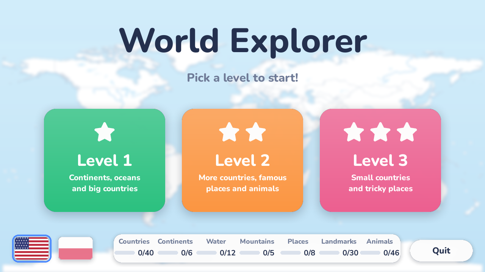
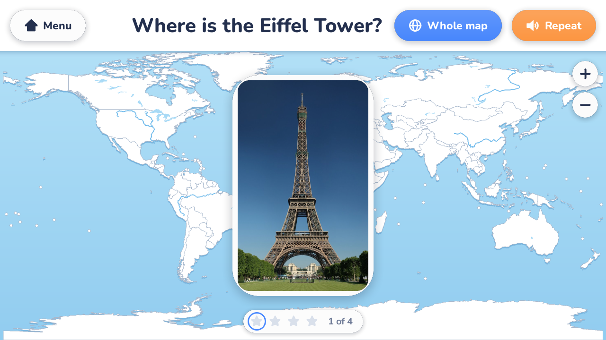
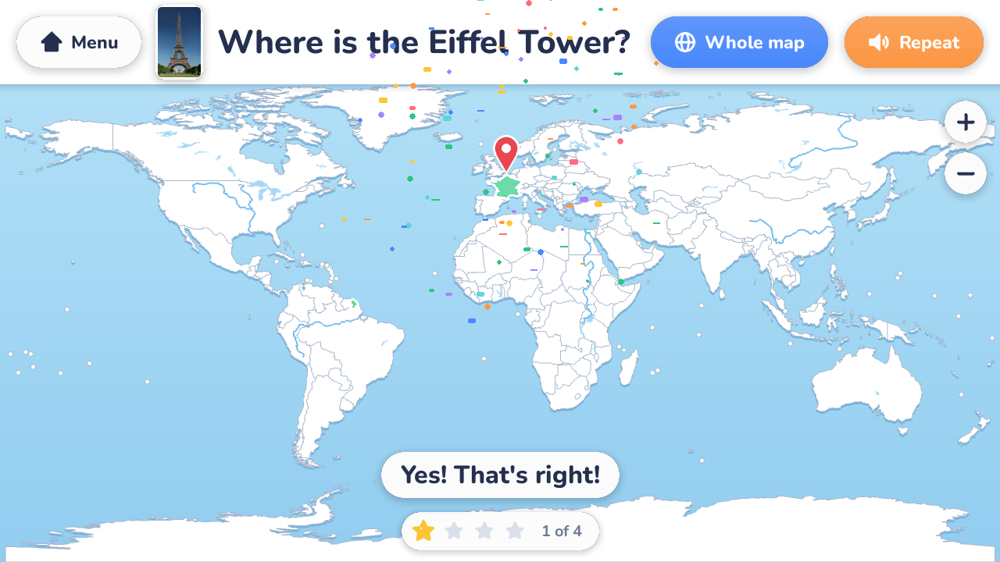
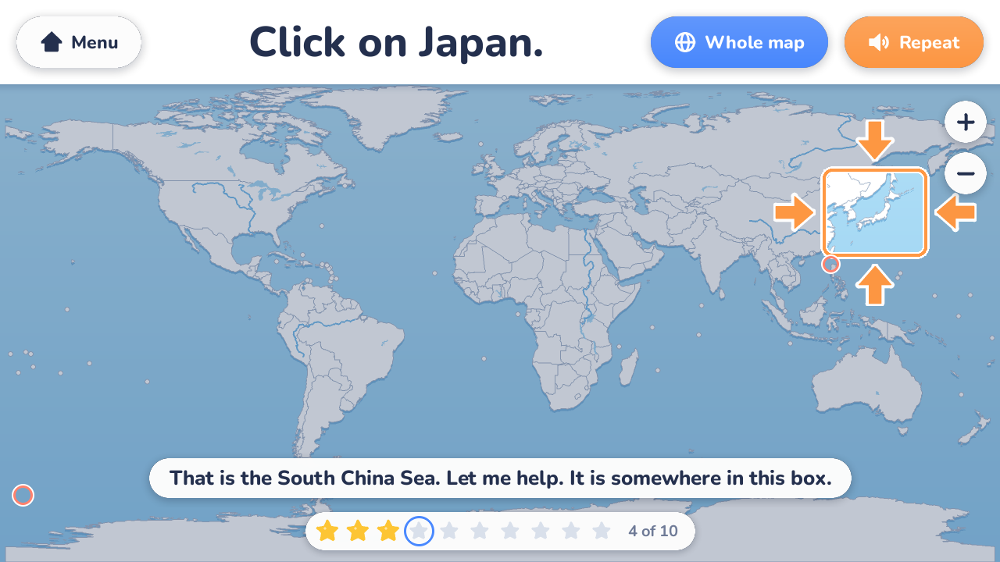

# World Explorer

A geography quiz for a young child who can read. The game shows a world map,
speaks a task ("Find France on the map.") and the child clicks the map. It is
mouse only, runs fullscreen, and nobody can lose. It can be played in English
and in Polish, and works offline.

There are 147 tasks: countries, continents, oceans, mountains and rivers,
46 animals ("Where do giraffes live?") and 30 famous places ("Where is the
Eiffel Tower?"), the last two with photos.

| | |
|---|---|
|  |  |
|  |  |

Windows, Python 3.14, pygame-ce. See [Setup](#setup) to run it from source
or [Building the .exe](#building-the-exe) for a single-file build.

## How to play

- The start screen has three level buttons. Clicking one starts a round of
  10 tasks.
- Two flags in the bottom-left corner of the start screen choose the
  language: the American flag for English, the Polish flag for Polish. The
  texts, the tasks and the voice all switch at once, and the choice is
  remembered for next time.
- Each task is spoken and also shown as text at the top of the screen.
- Questions about animals ("Where do giraffes live?") and famous places
  ("Where is the Eiffel Tower?") come with a photo. It is shown large for a
  moment when the question is asked, then shrinks to a thumbnail next to the
  question. Pointing at the thumbnail, or clicking it, shows it large again;
  a click while the large photo is up just puts it away.
- For a famous place the answer is the country it is in. When it is found
  (or shown), a pin marks the exact spot.
- Click the right place: it flashes green, the game praises the child and moves on
  to the next task.
- Click the wrong place: the game says "close" (the clicked country borders
  the answer, or the click was within about 1000 km of it) or "not quite",
  followed by the name of what was clicked ("That is Spain.").
- After 2 misses a box with four arrows pointing at its edges appears on the
  map: the answer is somewhere inside it. The box is larger than the answer
  and off-centre, so it narrows the search without giving it away.
- After 3 misses the answer starts to glow and the game asks the child to click it.
  From then on a wrong click only names what was clicked.
- A task earns one star if it was found before the answer had to be shown.
  The stars are counted up at the end of the round, and the best score per
  level is shown on the start screen.
- The start and end screens show the child's collection: how many countries,
  continents, waters (oceans, seas, rivers, lakes), mountains, places
  (deserts, islands, regions), landmarks and animals have been found so far,
  out of all there are in the game, for example "Countries 12/40". A task counts as
  found once the child has found it before the answer had to be shown, and it stays
  found for good. The collection is shared by both languages.
- Buttons on the play screen: **Menu** (back to the level choice), **Repeat**
  (says the task again), **Whole map** (resets zoom and pan), **+** / **-**
  (zoom).
- The mouse wheel zooms at the cursor, dragging pans the map. A click during
  which the mouse slips a little still counts as a click.
- Esc quits at any time. There is also a Quit button on the start and end
  screens.

A click within 15 screen pixels of the target counts, so small countries can
be hit; zooming in makes them easier still.

## Setup

Requires Python 3.14 on Windows 10 or 11.

With plain Python:

```
python -m venv .venv
.venv\Scripts\activate
pip install -r requirements.txt
```

With uv:

```
uv venv
.venv\Scripts\activate
uv pip install -r requirements.txt
```

Run it:

```
python main.py
```

Options:

- `--windowed` runs in a 1280x720 window instead of fullscreen.
- `--mute` turns off speech and sounds.
- `--selftest` opens a small window for about a second, starts a level and
  exits. Exit code 0 = everything loaded, 3 = everything works but there are
  no voice clips or no audio device, 2 = the tasks or data did not load cleanly. It is meant
  for checking a built .exe.

For running the tests or building the .exe, install `requirements-dev.txt`
instead (it includes the runtime requirements plus pytest and PyInstaller).

## Speech

The voice is pre-recorded. Every sentence the game can say (task prompts,
praise, "That is Germany." for each country and sea, the end-of-round lines:
533 sentences per language) was generated once with ElevenLabs and is stored
as an mp3 in `data/voice/en/` and `data/voice/pl/`. The game only plays those
files, so it works offline and needs no account or API key.

A sentence that has no clip is skipped silently; it is still shown as text.

### Fixing a clip that sounds wrong

If a name or a sentence is mispronounced, make that one clip again. Give the
sentence exactly as the game says it (it is shown in the banner at the bottom
of the screen, and listed in `data/voice/<language>/index.json`):

```
python tools/generate_voice.py --redo "That is Germany."
python tools/generate_voice.py --lang pl --redo "To Niemcy."
```

This costs only that sentence's characters. Each generation is a little
different, so simply running it again often fixes a bad take. If the model
keeps getting a name wrong, change how it is written in the `"names"` table
of the strings file (for example spell it the way it sounds) and generate
the new sentence as described next.

### After editing spoken text

Whenever you change something the game says, generate the missing clips:

```
python tools/generate_voice.py --dry-run     what would be generated, and how many characters
python tools/generate_voice.py               generate every missing English clip
python tools/generate_voice.py --lang pl     the same for Polish
python tools/generate_voice.py --prune       also delete clips no sentence uses any more
```

"Something the game says" means: a task prompt (`data/tasks.json` for
English, `"prompts"` in `data/strings.pl.json` for Polish), a phrase under
`"speech"` in a strings file, or a map name under `"names"`.

- Only sentences that have no clip yet are generated, so a rerun after a
  small edit costs a few characters. `--dry-run` shows the count first and
  spends nothing.
- A clip is named after a hash of its sentence, so a changed sentence is a
  new clip and the old file is left behind until you run `--prune`.
- `python -m pytest` fails with the list of sentences that have no clip, so
  a forgotten generation run is caught there.

### Cost and settings

- The tool needs an ElevenLabs API key in the environment variable
  `ELEVENLABS_API_KEY`, or in a `.env` file in the project folder
  (`ELEVENLABS_API_KEY=...`). `.env` is git-ignored. The key only needs the
  text-to-speech permission.
- With the default model (`eleven_multilingual_v2`) a character costs about
  0.4 credits: the English set (about 10,800 characters) cost 4,374 credits.
  Each run prints the exact number of credits it was charged.
- `--budget` (default 15000) is a hard cap on the characters one run may
  generate. `--reserve` (default 20000 credits that must remain) is only
  checked if the key is allowed to read the account balance.
- Each language has its own voice, set by `"voice_id"` at the top of its
  strings file (`"voice_name"` is only a note for humans): Lauren for
  English, Paula for Polish. `--voice <id>` overrides it for one run.
  Model and speed are options too (`--model`, `--speed`; speed is 0.92,
  slightly slow for a child).
- To redo a whole language with a different voice: change `"voice_id"` in
  its strings file, delete its folder under `data/voice/`, and run the tool
  for that language. A full set costs roughly 3,500 to 4,500 credits.
- For languages other than English the tool sends a short context sentence
  (`"voice_context"` in that language's strings file) with every request, so
  that a very short sentence such as "To Iran." is read in Polish rather
  than guessed to be English. The context is not billed.

The clips are generated audio from your ElevenLabs account; check their
terms for your plan before redistributing the game.

## Pictures

The photos shown with animal and landmark questions are in `data/pictures/`,
one file per picture id. They come from Wikimedia Commons under free
licences; the author and licence of each are listed in
`data/pictures/CREDITS.md` (and `credits.json`), as those licences require.
The game only reads the files; nothing is downloaded while playing.

`data/pictures/sources.json` says where each picture comes from: the main
picture of an English Wikipedia article (`{"article": "Lion"}`) or one exact
Commons file (`{"file": "Burj Khalifa (16260269606).jpg"}`).

```
python tools/fetch_pictures.py                     fetch every picture not downloaded yet
python tools/fetch_pictures.py --force lion        download this one again
python tools/fetch_pictures.py --search "red panda"    list Commons photos to choose from
python tools/fetch_pictures.py --sheet out         save overview sheets of all pictures in out/
```

- To change a picture: find a file name with `--search`, put it into
  `sources.json` as `{"file": "..."}`, and run the tool with `--force <id>`.
- You can also simply drop your own `<id>.jpg` into `data/pictures/`; then
  remove that id from `sources.json` so the tool leaves it alone.
- Only freely licensed pictures are accepted. Wikimedia limits how fast
  thumbnails may be downloaded, so a full run takes a few minutes.
- An animal question shows the picture named after the animal's key in
  `animals.json` (`lion.jpg`); a landmark question names its picture with
  `"picture"` in `tasks.json`. A question whose picture file is missing is
  simply asked without one.

## Editing tasks

Tasks are in `data/tasks.json`:

```json
{"id": "country-france", "type": "country", "prompt": "Find France on the map.", "targets": ["country:France"], "difficulty": 2}
```

- `id`: any unique text. Progress is stored under this id, so renaming it
  makes the game forget that task's history.
- `type`: `country`, `feature`, `animal` or `landmark`. The type decides
  which collection counter the task belongs to.
- `prompt`: the sentence that is spoken and shown.
- `targets`: one or more area ids. A click on any one of them is correct.
  `animal:<key>` stands for all the areas of that animal in `animals.json`.
- `difficulty`: 1, 2 or 3. This is the level the task appears in:
  1 = continents, oceans and big countries; 2 = more countries, famous places
  and animals; 3 = small countries and tricky places.

Animals are in `data/animals.json`, as the list of areas where the animal
lives (`"name"` is only a note for whoever edits the file; the game does not
read it):

```json
"panda": {
  "name": "pandas",
  "areas": ["country:China"]
}
```

A task then refers to it with `"targets": ["animal:panda"]`, and the game
shows `data/pictures/panda.jpg` with the question (see Pictures).

A landmark task names its picture and the exact spot:

```json
{"id": "landmark-eiffel-tower", "type": "landmark", "prompt": "Where is the Eiffel Tower?", "targets": ["country:France"], "difficulty": 2, "picture": "eiffel_tower", "pin": [2.29, 48.86]}
```

- `picture`: a picture id from `data/pictures/` (optional for any task).
- `pin`: `[longitude, latitude]` of the place; a pin is drawn there once
  the task is solved or the answer is shown (optional).

Adding an animal or a landmark therefore takes: the entry in `animals.json`
(animals only), the task in `tasks.json`, the Polish prompt in
`strings.pl.json`, a picture (`sources.json` and `fetch_pictures.py`), and
the voice clips (`generate_voice.py` for each language). The tests tell you
if any of these is missing.

### Area ids

Every clickable thing on the map has an id of the form `kind:Name`. The kinds
are `country:`, `continent:`, `ocean:`, `sea:`, `region:`, `river:` and
`lake:`, for example `country:France`, `ocean:Pacific Ocean`,
`region:Sahara`, `river:Nile`, `lake:Lake Victoria`. Ids are not case
sensitive. Countries can also be written with their three-letter code
(`country:FRA`).

To list all valid ids (933 of them: 242 countries, 7 continents, 5 oceans,
105 seas, 509 regions, 35 rivers, 30 lakes):

```
python -X utf8 -c "from geoquiz.mapdata import WorldMap; print('\n'.join(WorldMap.load().all_ids()))"
```

`-X utf8` is needed when the output is piped or redirected to a file, because
a few names contain accented letters.

### Mistakes in the files

The game checks the tasks at startup and never refuses to start because of
them. For each problem it prints a line such as
`tasks.json: task 'country-frnace': unknown area 'country:Frnace'` to the
console:

- an unknown area id or animal is ignored; if the task has other valid
  targets it stays, with only those;
- a task with no valid targets, an unknown `type`, a `difficulty` other than
  1, 2 or 3, an empty prompt or a duplicate `id` is skipped.

The built .exe has no console, so check edited files with `python main.py`
(or `python main.py --selftest`, which exits with code 2 if there was any
problem, including a spoken sentence without a voice clip).

A file that is not valid JSON at all (a missing comma, say) is different: the
game cannot read it and will not start.

One more rule: a level-1 task of type `country` is dropped if the country is
too small to click comfortably on the whole-world view (its largest piece is
smaller than a 3 x 3 degree square). This is reported the same way. Give such
a task difficulty 2 or 3 instead.

## Languages and translating

The game ships in English and Polish. Each language is one strings file:

- `data/strings.json`: English, the base language.
- `data/strings.pl.json`: Polish.

A strings file holds everything shown or spoken in that language: the
buttons (`"ui"`), the phrases (`"speech"`; where an entry is a list the game
picks one at random), and the spoken map names (`"names"`, keyed by area id:
`"country:Germany": "Niemcy"`). Keep the parts in `{curly braces}` as they
are.

The task prompts are the one thing split between files: the English prompt
sits next to each task in `data/tasks.json`, and a translation goes under
`"prompts"` in that language's strings file, keyed by the task id. A task
with no translated prompt is asked in English, and the tests report it.

So, when you add a task: add it to `tasks.json` with its English prompt, add
the Polish prompt to `"prompts"` in `strings.pl.json`, then run
`python tools/generate_voice.py` and `python tools/generate_voice.py --lang pl`.

Polish specifics, all in `strings.pl.json`:

- `"that_is"` is "To {name}." so that singular and plural names both work
  ("To Francja.", "To Niemcy.").
- `"round_end_exact"` has one sentence per score of a 10-task round, because
  the word for "stars" changes with the number (jedną gwiazdkę, trzy
  gwiazdki, pięć gwiazdek).
- Map names that are the same in both languages (Albania, Peru) are not
  listed; an area without an entry keeps its English name.

To add a third language, copy `strings.pl.json` to `strings.<code>.json`,
translate it, set `"language"` to the code and generate its voice with
`--lang <code>`. It appears on the start screen automatically; languages
other than English and Polish get a button with the code instead of a flag
(the flags are drawn in `geoquiz/gfx.py`).

## Progress

The game keeps `progress.json` next to itself (in the project folder, or next
to the .exe). It stores, per task, how often the child has seen it, how often it
took more than one try, whether it went wrong the last time, and whether the
child has ever found it unaided (the collection); the best star count
per level; and the language chosen on the start screen.
Deleting the file resets everything.

It is used to pick the 10 tasks of a round: first up to 5 tasks that went
wrong the last time they came up, then the ones seen least often. If the
folder is not writable (for example the .exe sits in `Program Files`), the
file goes to `%APPDATA%\KidsGeoQuiz` instead.

## Building the .exe

With `requirements-dev.txt` installed and the venv active, run
`build_exe.bat`, which does:

```
python -m PyInstaller --noconfirm --clean --onefile --windowed --name WorldExplorer --add-data "data;data" main.py
```

The result is the single file `dist\WorldExplorer.exe` (about 37 MB); it
needs nothing else. `build\` and `WorldExplorer.spec` are by-products and can
be deleted.

- The whole `data` folder is packed inside the .exe. A file placed next to
  the .exe in a `data` folder overrides the packed copy, file by file: to
  change the tasks on the child's computer, put an edited `tasks.json` in
  `data\` beside `WorldExplorer.exe`.
- `progress.json` is written next to the .exe.
- To check a build without starting the game:
  `Start-Process .\WorldExplorer.exe -ArgumentList '--selftest' -PassThru -Wait`
  in PowerShell and look at `ExitCode` (0 is good; see Setup for the others).

### Known issue: Windows Defender

On the machine where this was built, Windows Defender let a fresh copy of
the .exe run once (the self-test returned 0) and then reported that copy as
`Trojan:Win32/Bearfoos.A!ml` and refused to start it again. The `!ml` suffix
means a machine-learning guess, and unsigned single-file PyInstaller programs
are a well-known source of such false positives: the .exe is a small
unpacking stub with a large compressed payload attached, which is also what
real malware often looks like.

Nothing in this project works around that; what to do about it is your
decision. The usual options:

- restore the file and allow it in Windows Security (Virus & threat
  protection -> Protection history), or add an exclusion for the folder the
  game lives in;
- build a folder instead of a single file (replace `--onefile` with
  `--onedir` in `build_exe.bat`; the result is `dist\WorldExplorer\`), which
  is flagged much less often; this variant has not been tested here;
- skip the .exe and run `python main.py` from a shortcut;
- report the file to Microsoft as a false positive.

## Project layout

```
main.py                 entry point and command-line options
geoquiz/geometry.py     point-in-polygon, distances, simplification; pure maths
geoquiz/mapdata.py      loads the map; areas, ids, what is under a point, "close"
geoquiz/view.py         projection, zoom and pan (screen <-> longitude/latitude)
geoquiz/tasks.py        loads tasks, picks a round, judges clicks, saves progress
geoquiz/speech.py       plays the pre-recorded voice clips without blocking the game
geoquiz/voice_lines.py  the list of sentences the game can say, and each one's clip file
geoquiz/strings.py      access to strings.json, phrase rotation, spoken map names
geoquiz/maprender.py    draws the map and the highlights with pygame
geoquiz/gfx.py          drawing helpers for the UI: panels, stars, icons, fonts
geoquiz/ui.py           the screens, buttons and mouse handling; the main loop
geoquiz/paths.py        where data and progress.json live (also inside the .exe)
data/                   strings.json (English), strings.pl.json (Polish), tasks.json,
                        animals.json, map/, fonts/, pictures/, voice/en/, voice/pl/
tools/                  build_map_data.py (map converter), generate_voice.py (voice clips),
                        fetch_pictures.py (photos),
                        smoke_play.py (automated play)
tests/                  pytest unit tests for geometry, hit detection, rules, selection
```

Only `maprender.py`, `gfx.py` and `ui.py` use pygame for drawing; the rest
can be tested without a window.

## Tests

```
python -m pytest
```

657 tests, a few seconds. They cover the geometry, hit detection, the
"close" rule, task selection and the strings; none of them opens a window.

There is also an automated play-through that opens the real game and plays a
round with real mouse events, checking after each click that the game
reacted according to the rules:

```
python tools/smoke_play.py --level 1
```

It runs fullscreen and speaks; add `--windowed --mute` for a quiet run. See
the docstring at the top of the file for the other options. It never touches
the real `progress.json`.

## Map data and credits

- Map: [Natural Earth](https://www.naturalearthdata.com/) 1:50m, public
  domain, converted to one compact file, `data/map/world.json.gz`. The game
  never downloads anything.
- The map is drawn in the equirectangular projection (longitude and latitude
  used directly as x and y), so areas near the poles look larger than they
  are.
- Font: Nunito, under the SIL Open Font License 1.1. The font files and the
  licence text (`OFL.txt`) are in `data/fonts/`.

Regenerating the map file is not normally needed. If you want to: download
the five Natural Earth GeoJSON files listed at the top of
`tools/build_map_data.py` into a folder and run

```
python tools/build_map_data.py <that folder>
```

## Licences

- The code is under the MIT licence (see `LICENSE`).
- Map data: Natural Earth, public domain.
- Font: Nunito, SIL Open Font License 1.1 (`data/fonts/OFL.txt`).
- Photos in `data/pictures/`: Wikimedia Commons, each under its own free
  licence (mostly CC BY and CC BY-SA); authors and licences are listed in
  `data/pictures/CREDITS.md`. They are not covered by the MIT licence.
- Voice clips in `data/voice/`: generated with ElevenLabs (voices "Lauren"
  for English and "Paula" for Polish). Their use is subject to the
  ElevenLabs terms; if you fork the project, generate your own with
  `tools/generate_voice.py`.
